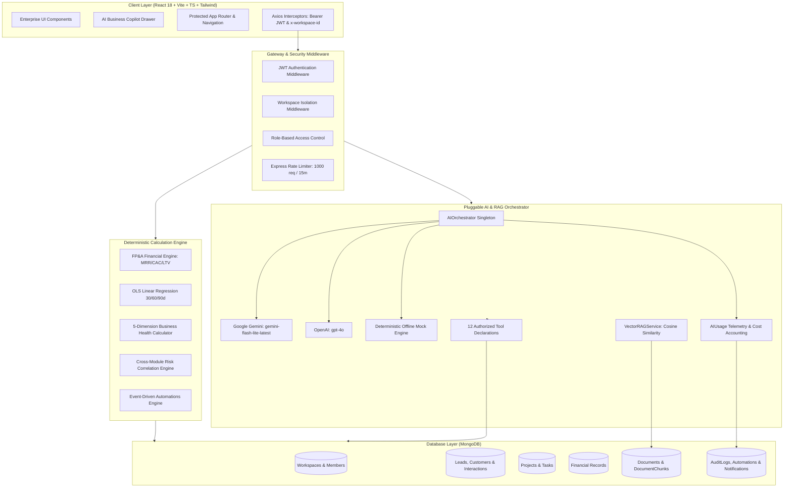
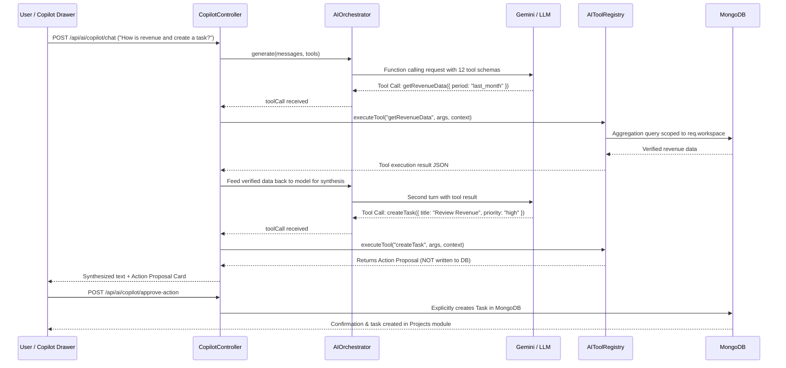

# VentureOS | System Architecture & Technical Design Specification

This document provides a deep architectural analysis of the **VentureOS** platform, detailing its multi-tenant partitioning, deterministic analytics engine, pluggable AI orchestrator, tool-calling loop, and document RAG pipeline.

---

## 1. High-Level System Architecture



---

## 2. Multi-Tenant Workspace Architecture

VentureOS implements **logical multi-tenancy** within a unified MongoDB database. Every business entity is scoped to an immutable `workspaceId`:

1. **Header-Based Scope Resolution**:
   - The authenticated client transmits `Authorization: Bearer <token>` and `x-workspace-id: <workspaceId>`.
   - The `resolveWorkspace` middleware checks the `WorkspaceMember` collection for an active record:
     ```ts
     const member = await WorkspaceMember.findOne({
       workspaceId: toObjectId(workspaceId),
       userId: toObjectId(req.user.userId),
       status: 'active'
     });
     ```
   - If no active membership is found, the request terminates immediately with `HTTP 403 Forbidden`.
2. **Compound Index Enforcements**:
   - All collection queries include `workspaceId`. Single-field scans across foreign tenants are prevented by compound indexes (`workspaceId + status`, `workspaceId + dueDate`, etc.).

---

## 3. Deterministic Analytics vs. Generative AI Separation

To maintain strict fiduciary and operational integrity, VentureOS **never** relies on an LLM for arithmetic computations or business metrics. All calculations are executed deterministically in TypeScript:

### Mathematical Formulations:

1. **Monthly Recurring Revenue (MRR)**:
   $$\text{MRR} = \sum_{i \in \text{Recurring Revenue}} \text{Amount}_i$$

2. **Customer Acquisition Cost (CAC)**:
   $$\text{CAC} = \frac{\sum \text{Marketing & Sales Expenses (Last 90 Days)}}{\text{New Customers Acquired (Last 90 Days)}}$$

3. **Customer Lifetime Value (LTV)**:
   $$\text{LTV} = \frac{\text{Average Monthly Revenue Per Customer}}{\text{Monthly Churn Rate}}$$

4. **Monthly Burn Rate & Cash Runway**:
   $$\text{Net Monthly Burn} = \text{Monthly Expenses} - \text{Monthly Revenue}$$
   $$\text{Runway (Months)} = \frac{\text{Total Cash Reserves}}{\text{Net Monthly Burn}}$$

5. **30/60/90-Day Predictive Forecasting (Ordinary Least Squares - OLS)**:
   $$\hat{y} = \beta_0 + \beta_1 x$$
   $$\beta_1 = \frac{\sum (x_i - \bar{x})(y_i - \bar{y})}{\sum (x_i - \bar{x})^2}, \quad \beta_0 = \bar{y} - \beta_1 \bar{x}$$
   The linear trend projects financial runway 30, 60, and 90 days forward. The AI layer receives these pre-computed numbers and adds qualitative business commentary.

6. **5-Dimension Composite Business Health Index**:
   $$\text{Health Index} = 0.25 \cdot S + 0.25 \cdot C + 0.20 \cdot F + 0.15 \cdot O + 0.15 \cdot M$$
   - $S$: Sales pipeline velocity & win rate score $(0-100)$
   - $C$: Customer retention & health score $(0-100)$
   - $F$: Profit margin & cash runway score $(0-100)$
   - $O$: Project milestone delivery & task completion ratio $(0-100)$
   - $M$: Marketing ROI & CAC efficiency score $(0-100)$

---

## 4. AI Tool Calling & Human-in-the-Loop Sequence


