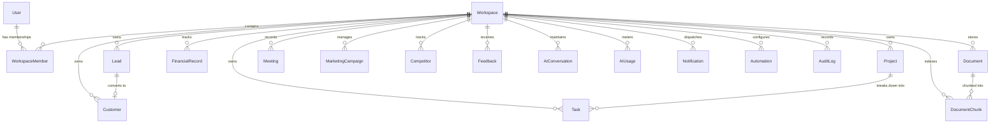

# VentureOS | Database Design & Data Modeling Specification

This document provides the authoritative database design specification for **VentureOS**, covering all 20 Mongoose schemas, relationships, indexing strategies, multi-tenant workspace partitioning, and aggregation pipelines.

---

## 1. Data Modeling Philosophy & Multi-Tenancy

Every operational record in VentureOS belongs to a specific workspace. Data isolation is maintained through two immutable rules:
1. **Mandatory `workspaceId` Foreign Key**: Every document (except `User` and global metadata) contains a non-nullable `workspaceId: { type: Schema.Types.ObjectId, ref: 'Workspace', required: true }`.
2. **Compound Indexing on (`workspaceId`, `...`)**: Every collection indexes `workspaceId` as the primary prefix of compound indexes, ensuring all queries execute index-covered scans constrained strictly to the tenant.



---

## 2. Complete Model Catalog (20 Collections)

### 1. `User` (`users`)
Represents global user identities across all workspaces.
- **Fields**:
  - `name` (String, required, trim)
  - `email` (String, required, unique, lowercase, indexed)
  - `passwordHash` (String, required)
  - `avatarUrl` (String, default '')
  - `isEmailVerified` (Boolean, default true)
  - `preferences` (Object: `theme`: 'light'|'dark'|'system', `currency`: 'USD')
  - `notificationSettings` (Object: `emailAlerts`, `inAppAlerts`, `riskAlerts`)
  - `lastLoginAt` (Date)
- **Indexes**: `{ email: 1 } (unique)`

### 2. `Workspace` (`workspaces`)
Represents isolated tenant boundaries.
- **Fields**:
  - `name` (String, required, trim)
  - `slug` (String, required, unique, lowercase, indexed)
  - `ownerId` (ObjectId -> User, required)
  - `industry` (String, default 'Technology')
  - `website` (String)
  - `description` (String)
  - `targetAudience` (String)
  - `settings` (Object: `currency`, `fiscalYearStart`, `timezone`)
  - `subscriptionTier` (String: 'free'|'pro'|'enterprise')
- **Indexes**: `{ slug: 1 } (unique)`, `{ ownerId: 1 }`

### 3. `WorkspaceMember` (`workspacemembers`)
Junction collection mapping users to workspaces with RBAC roles.
- **Fields**:
  - `workspaceId` (ObjectId -> Workspace, required, indexed)
  - `userId` (ObjectId -> User, required, indexed)
  - `role` (String: 'Owner'|'Admin'|'Manager'|'Employee'|'Viewer', default 'Employee')
  - `status` (String: 'active'|'invited', default 'active')
  - `invitedEmail` (String, lowercase, trim)
  - `joinedAt` (Date, default Date.now)
- **Indexes**: `{ workspaceId: 1, userId: 1 } (unique)`

### 4. `Lead` (`leads`)
Sales CRM pipeline opportunities.
- **Fields**:
  - `workspaceId` (ObjectId -> Workspace, required, indexed)
  - `name` (String, required, trim)
  - `company` (String, required)
  - `email` (String, required, lowercase)
  - `phone` (String)
  - `status` (String: 'New'|'Contacted'|'Qualified'|'Proposal'|'Negotiation'|'Won'|'Lost', default 'New')
  - `dealValue` (Number, default 0)
  - `industry` (String)
  - `source` (String, default 'Inbound')
  - `assignedEmployeeId` (ObjectId -> User)
  - `notes` (String)
  - `score` (Number, 0-100, AI calculated)
  - `scoreReasons` ([String])
  - `aiSummary` (String)
  - `convertedToCustomerId` (ObjectId -> Customer)
  - `convertedAt` (Date)
- **Indexes**: `{ workspaceId: 1, status: 1 }`, `{ workspaceId: 1, dealValue: -1 }`, `{ workspaceId: 1, assignedEmployeeId: 1 }`

### 5. `Customer` (`customers`)
Active client accounts and Customer 360 intelligence.
- **Fields**:
  - `workspaceId` (ObjectId -> Workspace, required, indexed)
  - `name` (String, required, trim)
  - `company` (String, required)
  - `email` (String, required, lowercase)
  - `phone` (String)
  - `status` (String: 'active'|'churn_risk'|'churned', default 'active')
  - `lifetimeValue` (Number, default 0)
  - `monthlyRecurringRevenue` (Number, default 0)
  - `customerHealthScore` (Number, 0-100, default 80)
  - `churnRisk` (String: 'low'|'medium'|'high', default 'low')
  - `churnRiskReasons` ([String])
  - `assignedAccountManagerId` (ObjectId -> User)
  - `onboardingDate` (Date, default Date.now)
  - `lastInteractionDate` (Date)
  - `tags` ([String])
- **Indexes**: `{ workspaceId: 1, status: 1 }`, `{ workspaceId: 1, customerHealthScore: 1 }`, `{ workspaceId: 1, monthlyRecurringRevenue: -1 }`

### 6. `Interaction` (`interactions`)
Customer & lead communication history (emails, calls, meetings, notes).
- **Fields**:
  - `workspaceId` (ObjectId -> Workspace, required, indexed)
  - `entityType` (String: 'lead'|'customer', required)
  - `entityId` (ObjectId, required)
  - `type` (String: 'email'|'call'|'meeting'|'note', required)
  - `summary` (String, required)
  - `sentimentScore` (Number, -1.0 to 1.0)
  - `loggedByUserId` (ObjectId -> User)
  - `date` (Date, default Date.now)
- **Indexes**: `{ workspaceId: 1, entityId: 1, date: -1 }`

### 7. `Project` (`projects`)
Strategic initiatives and operational projects.
- **Fields**:
  - `workspaceId` (ObjectId -> Workspace, required, indexed)
  - `name` (String, required, trim)
  - `description` (String)
  - `status` (String: 'planning'|'in_progress'|'on_hold'|'completed'|'cancelled', default 'planning')
  - `priority` (String: 'low'|'medium'|'high'|'urgent', default 'medium')
  - `startDate` (Date), `dueDate` (Date)
  - `ownerId` (ObjectId -> User)
  - `budget` (Number, default 0)
  - `aiGenerated` (Boolean, default false)
  - `progressPercentage` (Number, 0-100, default 0)
  - `milestones` ([{ title: String, dueDate: Date, completed: Boolean }])
  - `tags` ([String])
- **Indexes**: `{ workspaceId: 1, status: 1 }`, `{ workspaceId: 1, dueDate: 1 }`

### 8. `Task` (`tasks`)
Operational work items and Kanban cards.
- **Fields**:
  - `workspaceId` (ObjectId -> Workspace, required, indexed)
  - `projectId` (ObjectId -> Project, indexed)
  - `title` (String, required, trim)
  - `description` (String)
  - `status` (String: 'todo'|'in_progress'|'review'|'done', default 'todo')
  - `priority` (String: 'low'|'medium'|'high'|'urgent', default 'medium')
  - `assigneeId` (ObjectId -> User, indexed)
  - `dueDate` (Date)
  - `subtasks` ([{ title: String, completed: Boolean }])
  - `originType` (String: 'manual'|'meeting'|'crm_followup'|'risk_recommendation'|'ai_project_plan'|'automation')
  - `originId` (ObjectId)
  - `comments` ([{ authorId: ObjectId, text: String, createdAt: Date }])
  - `tags` ([String])
- **Indexes**: `{ workspaceId: 1, status: 1 }`, `{ workspaceId: 1, assigneeId: 1 }`, `{ workspaceId: 1, dueDate: 1 }`

### 9. `Document` (`documents`)
Metadata for uploaded files in the RAG knowledge base.
- **Fields**:
  - `workspaceId` (ObjectId -> Workspace, required, indexed)
  - `title` (String, required)
  - `originalFilename` (String, required)
  - `fileType` (String: 'pdf'|'docx'|'csv'|'txt')
  - `fileSize` (Number)
  - `storagePath` (String, required)
  - `status` (String: 'uploaded'|'processing'|'ready'|'failed', default 'uploaded')
  - `chunksCount` (Number, default 0)
  - `extractedText` (String)
  - `summary` (String)
  - `keyInfo` ([String])
  - `requirements` ([String])
  - `risks` ([String])
  - `deadlines` ([{ description: String, date: String }])
  - `errorMessage` (String)
- **Indexes**: `{ workspaceId: 1, createdAt: -1 }`

### 10. `DocumentChunk` (`documentchunks`)
Vector embeddings and text chunks for similarity search.
- **Fields**:
  - `workspaceId` (ObjectId -> Workspace, required, indexed)
  - `documentId` (ObjectId -> Document, required, indexed)
  - `chunkIndex` (Number, required)
  - `content` (String, required)
  - `embedding` ([Number], vector array: 768 or 64 dimensions)
  - `tokenCount` (Number)
  - `metadata` (Object: `page`, `section`, `wordCount`)
- **Indexes**: `{ workspaceId: 1, documentId: 1 }`, `{ workspaceId: 1, chunkIndex: 1 }`

### 11. `Meeting` (`meetings`)
Meeting intelligence transcripts and extracted action items.
- **Fields**:
  - `workspaceId` (ObjectId -> Workspace, required, indexed)
  - `title` (String, required)
  - `date` (Date, default Date.now)
  - `attendees` ([String])
  - `transcriptText` (String, required)
  - `summary` (String)
  - `keyDecisions` ([String])
  - `requirements` ([String])
  - `actionItems` ([{ title: String, suggestedAssignee: String, daysUntilDue: Number, convertedToTaskId: ObjectId }])
  - `risks` ([String])
- **Indexes**: `{ workspaceId: 1, date: -1 }`

### 12. `Competitor` (`competitors`)
Market intelligence and competitor feature parity tracking.
- **Fields**:
  - `workspaceId` (ObjectId -> Workspace, required, indexed)
  - `name` (String, required)
  - `website` (String)
  - `pricingModel` (String)
  - `strengths` ([String]), `weaknesses` ([String])
  - `features` ([{ name: String, supported: Boolean }])
  - `swotAnalysis` (Object: `strengths`, `weaknesses`, `opportunities`, `threats`)
  - `marketWhitespace` ([String])
- **Indexes**: `{ workspaceId: 1, name: 1 }`

### 13. `MarketingCampaign` (`marketingcampaigns`)
Campaign tracking and AI Content Studio generation.
- **Fields**:
  - `workspaceId` (ObjectId -> Workspace, required, indexed)
  - `name` (String, required)
  - `platform` (String: 'LinkedIn'|'Twitter'|'Google Ads'|'Meta'|'Email'|'Multi-Channel')
  - `status` (String: 'planning'|'active'|'paused'|'completed', default 'planning')
  - `budget` (Number, default 0), `spend` (Number, default 0)
  - `impressions` (Number), `clicks` (Number), `conversions` (Number)
  - `roi` (Number), `cac` (Number), `ctr` (Number)
  - `aiGeneratedContent` (Object: `strategy`, `personas`, `socialPosts`, `emailSequences`, `adCopy`)
- **Indexes**: `{ workspaceId: 1, status: 1 }`

### 14. `Feedback` (`feedbacks`)
Customer sentiment logs, survey responses, and CSV imports.
- **Fields**:
  - `workspaceId` (ObjectId -> Workspace, required, indexed)
  - `customerId` (ObjectId -> Customer)
  - `customerName` (String)
  - `source` (String: 'nps'|'csat'|'email'|'support'|'review'|'csv_import')
  - `content` (String, required)
  - `rating` (Number, 1-5)
  - `sentimentScore` (Number, -1.0 to 1.0)
  - `topic` (String: 'product'|'pricing'|'support'|'onboarding'|'general')
  - `urgency` (String: 'low'|'medium'|'high')
  - `suggestedAction` (String)
- **Indexes**: `{ workspaceId: 1, sentimentScore: 1 }`, `{ workspaceId: 1, urgency: 1 }`

### 15. `FinancialRecord` (`financialrecords`)
General transaction ledger for revenue and expenditures.
- **Fields**:
  - `workspaceId` (ObjectId -> Workspace, required, indexed)
  - `type` (String: 'revenue'|'expense', required)
  - `category` (String: 'Subscription'|'Enterprise Contract'|'Consulting'|'Payroll'|'Infrastructure'|'Marketing'|'Software'|'Other')
  - `amount` (Number, required)
  - `currency` (String, default 'USD')
  - `date` (Date, required)
  - `recurring` (Boolean, default false)
  - `description` (String)
- **Indexes**: `{ workspaceId: 1, date: -1 }`, `{ workspaceId: 1, type: 1, recurring: 1 }`

### 16. `AIConversation` (`aiconversations`)
Multi-turn Copilot conversation sessions.
- **Fields**:
  - `workspaceId` (ObjectId -> Workspace, required, indexed)
  - `userId` (ObjectId -> User, required, indexed)
  - `title` (String, default 'New Conversation')
  - `messages` ([{
      role: 'user'|'assistant'|'system',
      content: String,
      timestamp: Date,
      toolsUsed: [String],
      actionProposal: { isActionProposal: Boolean, actionType: String, payload: Object, status: String }
    }])
  - `model` (String)
- **Indexes**: `{ workspaceId: 1, userId: 1, updatedAt: -1 }`

### 17. `AIUsage` (`aiusages`)
Token metering and cost monitoring telemetry.
- **Fields**:
  - `workspaceId` (ObjectId -> Workspace, required, indexed)
  - `userId` (ObjectId -> User)
  - `module` (String: 'copilot'|'lead_scoring'|'project_planner'|'rag'|'marketing_studio'|'etc')
  - `model` (String, required)
  - `promptTokens` (Number), `completionTokens` (Number), `totalTokens` (Number)
  - `estimatedCost` (Number, USD)
  - `latencyMs` (Number)
  - `status` (String: 'success'|'error')
- **Indexes**: `{ workspaceId: 1, createdAt: -1 }`, `{ module: 1, createdAt: -1 }`

### 18. `Notification` (`notifications`)
In-app alerts and risk dispatches.
- **Fields**:
  - `workspaceId` (ObjectId -> Workspace, required, indexed)
  - `userId` (ObjectId -> User, indexed)
  - `title` (String, required)
  - `message` (String, required)
  - `type` (String: 'lead'|'task'|'feedback'|'risk'|'automation'|'system')
  - `link` (String)
  - `read` (Boolean, default false)
- **Indexes**: `{ workspaceId: 1, userId: 1, read: 1, createdAt: -1 }`

### 19. `Automation` (`automations`)
Event-driven trigger-action automation rules.
- **Fields**:
  - `workspaceId` (ObjectId -> Workspace, required, indexed)
  - `name` (String, required)
  - `trigger` (String: 'lead_won'|'customer_churn_risk'|'project_delayed'|'task_overdue'|'high_expense')
  - `action` (String: 'create_project'|'create_task'|'send_notification'|'assign_lead')
  - `config` (Object)
  - `enabled` (Boolean, default true)
- **Indexes**: `{ workspaceId: 1, enabled: 1 }`

### 20. `AuditLog` (`auditlogs`)
Immutable compliance trail of state-changing operations.
- **Fields**:
  - `workspaceId` (ObjectId -> Workspace, required, indexed)
  - `userId` (ObjectId -> User, required)
  - `action` (String, required, e.g. 'lead.convert', 'project.ai_plan_approved')
  - `resource` (String, required, e.g. 'Lead', 'Project', 'Task')
  - `resourceId` (String, required)
  - `details` (Object)
  - `ipAddress` (String)
- **Indexes**: `{ workspaceId: 1, createdAt: -1 }`, `{ resource: 1, resourceId: 1 }`

---

## 3. Key Aggregation Pipelines

### Financial Ledger Summary Pipeline
```ts
await FinancialRecord.aggregate([
  { $match: { workspaceId: toObjectId(wsId) } },
  {
    $group: {
      _id: '$type',
      total: { $sum: '$amount' },
      recurringTotal: {
        $sum: { $cond: [{ $eq: ['$recurring', true] }, '$amount', 0] }
      }
    }
  }
]);
```

### CRM Sales Pipeline Stage Breakdown
```ts
await Lead.aggregate([
  { $match: { workspaceId: toObjectId(wsId) } },
  {
    $group: {
      _id: '$status',
      count: { $sum: 1 },
      totalValue: { $sum: '$dealValue' },
      avgScore: { $avg: '$score' }
    }
  }
]);
```
