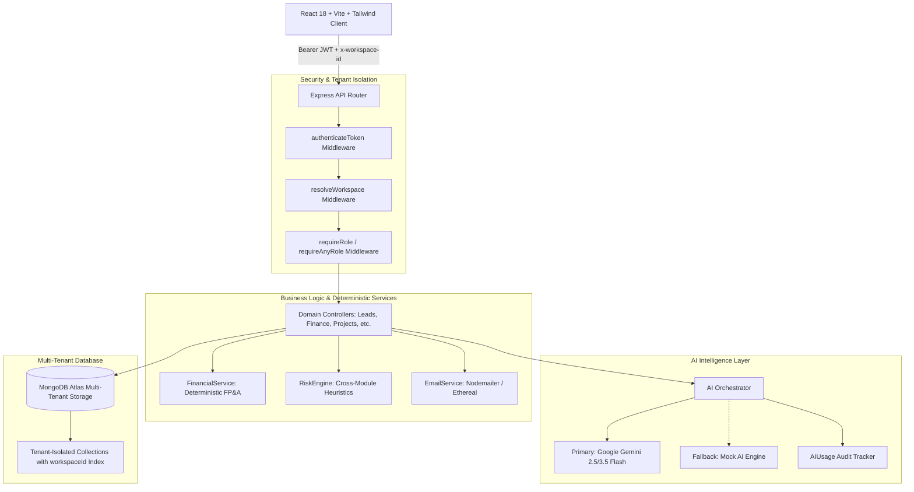
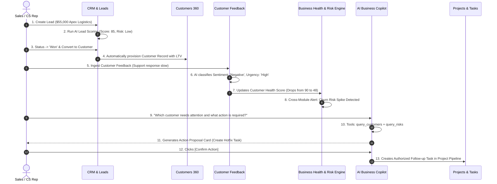

# VentureOS — Complete User Manual, End-to-End Business Flow & Manual Verification Guide

---

## Part 1: Product Concept & Architecture Overview

### 1.1 Simple English Explanation: What is VentureOS?
**VentureOS** is an **All-in-One AI-Powered Enterprise Business Operating System**. 
Instead of paying for 5 to 7 separate, disconnected SaaS tools (like Salesforce for CRM, Jira for project management, QuickBooks for finance, Zendesk for support, and ChatGPT for AI), VentureOS unifies all your company's core operations under **one single roof**.

#### Who uses VentureOS?
- **Founders & CEOs (Owners):** Monitor overall company health, cash runway, risk alerts, and high-level strategy.
- **Operations & General Managers:** Track project delivery, manage teams, and prevent operational bottlenecks.
- **Sales & Revenue Teams:** Manage leads, generate AI sales pitches, track deals, and convert leads to paying customers.
- **Customer Success Teams:** Monitor customer satisfaction, analyze feedback sentiment, and proactively prevent churn.
- **Finance Teams:** Track revenue and expenses, monitor MRR/ARR, and review deterministic cash runway projections.

#### What core business problems does it solve?
1. **Tool Fragmentation & Data Silos:** In disconnected systems, customer complaints in Zendesk never reach sales reps in Salesforce. In VentureOS, customer feedback automatically updates the customer's health score, alerts the CRM, and feeds into the cross-module Risk Engine.
2. **LLM Arithmetic Hallucinations:** Most AI tools hallucinate financial numbers. VentureOS strictly separates **deterministic math** (100% computed by backend algorithms) from **generative AI** (which only interprets trends and provides strategic prose).
3. **Runaway AI & Uncontrolled Mutations:** VentureOS enforces **Human-in-the-Loop** authorization. The AI Copilot cannot silently insert or delete database records; it must generate a structured **Action Proposal Card** that requires explicit human review and approval.

---

### 1.2 Roman Urdu Main Samjhein: VentureOS Kya Hai?
**VentureOS ek mukammal AI-powered Business Operating System hai.**
Aam tor par kisi bhi company ko chalane ke liye mukhtalif software lene parte hain:
- Sales aur Leads ke liye alag CRM (jaise HubSpot).
- Projects ke liye alag tool (jaise Trello ya Jira).
- Finance aur accounting ke liye alag software.
- Customer support aur feedback ke liye alag tool.
- Aur phir AI ke liye alag ChatGPT.

**Masla:** Yeh saare tools aapas mein baat nahi karte! Agar kisi customer ka support ticket kharab ho ya woh gussa ho, toh sales team ko pata hi nahi chalta.
**VentureOS ka Hal:** VentureOS in saari 10 branches ko ek single database (MongoDB) aur ek single dashboard par jod deta hai.

#### Asaan Lafzon Mein Kaam Kaise Hota Hai:
1. **Jab ek business register hota hai:** System foran uss user ko **Owner** banata hai, uski company ke naam par ek alag **Tenant Workspace** kholta hai, aur MongoDB mein securely save kar deta hai.
2. **Data Entry:** Aap leads, customers, projects, ya expenses enter karte hain.
3. **Backend Processing:** Backend deterministic algorithms chala kar accurate profit, MRR, aur health score calculate karta hai (bina kisi AI ghalati ke).
4. **AI Ka Kirdar:** Gemini AI sirf qualitative analysis karta hai — jaise lead ko score karna, cold outreach email draft likhna, customer feedback ka sentiment nikalna, aur project plan banana.
5. **Human-in-the-Loop:** AI kabhi bhi aapki permission ke baghair database mein tabdeeli nahi kar sakta. Copilot pehle ek "Action Card" dikhata hai. Jab aap "Confirm" dabate hain, tabhi record banta hai.

---

### 1.3 Role-Based Access Control (RBAC) & Permissions

In VentureOS, every workspace member has an assigned role enforced by `server/src/middleware/rbac.ts`:

| Role Name | Authority Level | Permitted Capabilities | Restrictions |
| :--- | :---: | :--- | :--- |
| **Owner** | `Level 5 (Max)` | Complete workspace control; edit company profile; invite members; change roles; delete workspace; view all financials, audit logs, and AI telemetry. | None. |
| **Admin** | `Level 4` | User and team management; company profile updates; audit logs; AI usage monitoring; all module CRUD actions. | Cannot delete the workspace or demote the primary Owner. |
| **Manager** | `Level 3` | Lead scoring; project and task assignments; marketing campaign creation; feedback analysis; action proposal approvals. | Cannot alter workspace billing/settings or delete team members. |
| **Employee** | `Level 2` | Create and edit leads, customers, tasks, and feedback; run AI Sales Assistant; interact with Copilot. | Cannot approve high-risk actions or modify workspace configurations. |
| **Viewer** | `Level 1` | Read-only visibility into dashboards, pipelines, project boards, and analytics. | Cannot create, update, or delete any business records. |

---

### 1.4 High-Level Architecture Diagram

---

### 1.5 Cross-Module Data Flow Diagram

---

## Part 2: Application Sitemap & Module Mapping

| Navigation Menu Label | Frontend URL | Backend API Route | Primary Database Models | Purpose / Capabilities |
| :--- | :--- | :--- | :--- | :--- |
| **Executive Dashboard** | `/dashboard` | `GET /api/dashboard/overview` `GET /api/dashboard/kpis` | `Lead`, `Customer`, `Project`, `FinancialRecord` | Real-time overview of revenue, MRR, pipeline, churn risk, and operational velocity. |
| **Business Health** | `/health` | `GET /api/dashboard/overview` | `Customer`, `FinancialRecord`, `Lead` | Holistic operational health score (0-100) aggregating financial, sales, and CS signals. |
| **Risk Center** | `/risk` | `GET /api/dashboard/overview` | `Customer`, `Project`, `FinancialRecord` | Cross-module anomaly detection (pipeline stagnation, churn spikes, budget burn). |
| **CRM & Leads** | `/crm` | `GET/POST /api/leads` `POST /api/leads/:id/score` `POST /api/leads/:id/sales-assistant` `POST /api/leads/:id/convert-to-customer` | `Lead`, `Customer`, `Interaction` | Kanban/Table pipeline; AI Lead Scoring; AI Outreach Email Pitch; Customer Conversion. |
| **Customers 360** | `/customers` | `GET/POST /api/customers` `POST /api/customers/:id/churn-risk` | `Customer`, `Interaction`, `Feedback` | Customer directory, ARR/MRR tracking, churn risk scoring, interaction history. |
| **Projects & Tasks** | `/projects` | `GET/POST /api/projects` `POST /api/projects/plan-ai` `GET/POST /api/projects/:id/tasks` | `Project`, `Task` | Milestone tracking, task assignees, priorities, and AI-assisted project planning. |
| **Finance & Forecast** | `/finance` | `GET/POST /api/finance/records` `GET /api/finance/summary` `GET /api/finance/forecast` | `FinancialRecord` | Deterministic accounting (Revenue, Expenses, Net Margin, Runway, 30/60/90-day linear trend). |
| **Document RAG** | `/documents` | `POST /api/documents/upload` `POST /api/documents/query` | `Document`, `DocumentChunk` | Semantic chunking, vector embedding, grounded question answering with citations. |
| **Meeting Intelligence** | `/meetings` | `GET/POST /api/meetings` `POST /api/meetings/ingest` | `Meeting`, `Task` | Transcript summarization, key decisions, and action item task extraction. |
| **Marketing Studio** | `/marketing` | `GET/POST /api/marketing/campaigns` `POST /api/marketing/generate-strategy` | `MarketingCampaign` | Audience segmentation, multi-channel strategy, AI copy generation. |
| **Competitors & SWOT** | `/competitors` | `GET/POST /api/competitors` `POST /api/competitors/:id/swot` | `Competitor` | Competitive benchmark matrix, feature gaps, and strategic differentiation battlecards. |
| **Customer Feedback** | `/feedback` | `GET/POST /api/feedback` `POST /api/feedback/analyze-ai` | `Feedback`, `Customer` | Multi-channel feedback repository, sentiment classification, urgency detection. |
| **Automations Engine** | `/automations` | `GET/POST /api/automations` | `Automation` | Event-driven triggers: auto-score leads, churn risk alerts, budget threshold warnings. |
| **Admin & Audit Logs** | `/admin` | `GET /api/admin/users` `GET /api/admin/audit-logs` `GET /api/admin/ai-usage` | `User`, `AuditLog`, `AIUsage` | Security auditing, IP tracking, token expenditure, and AI latency telemetry. |
| **Workspace Settings** | `/settings` | `GET/PUT /api/workspaces/current` `GET/POST /api/workspaces/members` | `Workspace`, `WorkspaceMember` | Company profile (industry, description, currency), team invitations, RBAC roles. |
| **AI Copilot** | *Modal Drawer* | `POST /api/copilot/chat` `POST /api/copilot/execute-action` | `AIConversation`, `Task`, `Lead`, `Project` | Tool-calling assistant; business Q&A; human-in-the-loop action proposals. |

---

## Part 3: Step-by-Step Manual Verification Suite (22 Tests)

---

### TEST 1 — Open the Public Website & Landing Page
- **Page Name:** Public Landing Page
- **Navigation:** Open browser and visit `http://localhost:5173/` (or your live deployment URL).
- **Purpose:** Verify brand presentation, responsive layout, feature showcases, and public navigation.
- **Preconditions:** Server and Client processes running.
- **Step-by-Step Actions:**
  1. Open `http://localhost:5173/` in your browser.
  2. Inspect the **Navbar**: Click on logo, verify "Sign In" and "Deploy Workspace" buttons exist.
  3. Inspect the **Interactive Robot** on the hero section: Move your cursor across the page and observe the robot eyes tracking your cursor.
  4. Scroll down through the 10 feature cards (Core Intelligence, RAG, Financials, etc.).
  5. Expand one of the FAQ accordions.
  6. Click **"Deploy Workspace"** or **"Start Free Trial"** to navigate to `/register`.
- **Expected Result:** Homepage loads cleanly with dark glassmorphism styling, zero console errors, smooth interactive robot tracking, and fast navigation to registration.
- **Verification Method:** Inspect browser console (`F12`), ensure no React runtime crashes.

| Test ID | Feature | Action | Expected Result | Verification Method | Status |
| :--- | :--- | :--- | :--- | :--- | :---: |
| `TEST-01` | Public Landing Page | Navigate to `/` and test interactions | Seamless visual presentation, robot tracking, and working register links | Browser inspection | NOT TESTED |

---

### TEST 2 — Register a New Business User Account
- **Page Name:** User Registration (`/register`)
- **Navigation:** Click "Deploy Workspace" on homepage or navigate directly to `http://localhost:5173/register`.
- **Purpose:** Test new tenant provisioning, password hashing, verification token generation, and workspace creation.
- **Preconditions:** Logged out.
- **Data to Enter (from `docs/MANUAL_TEST_DATA.md`):**
  - **Full Name:** `Marcus Vance`
  - **Work Email:** `owner@example.com` *(or a real email you control if verifying live inbox receipt)*
  - **Password:** `Northstar2026!Secure`
  - **Company / Organization:** `Northstar Business Systems`
  - **Primary Industry:** `SaaS / Software`
- **Step-by-Step Actions:**
  1. Fill in all 5 form fields.
  2. Click **"Deploy Organization Workspace"**.
  3. Observe the loading state and redirection.
- **What Happens Internally:**
  - Backend `auth.controller.ts:register` hashes password with bcrypt (salt 10).
  - Creates record in `users` collection with `isEmailVerified: false`.
  - Dispatches verification email via `EmailService`.
  - Creates tenant `workspaces` record for "Northstar Business Systems".
  - Creates `workspace_members` record designating `Marcus Vance` as **Owner**.
  - Generates JWT token and auto-authenticates user to `/dashboard`.
- **What Success Looks Like:** Browser automatically redirects to `/dashboard`. Active workspace shows "Northstar Business Systems" in sidebar and topbar.
- **Troubleshooting:** If registration fails with "Account already exists", use a new email address or clean local test database.

| Test ID | Feature | Action | Expected Result | Verification Method | Status |
| :--- | :--- | :--- | :--- | :--- | :---: |
| `TEST-02` | User Registration | Submit registration form | User and Workspace created; redirected to Dashboard | Check DB & active tenant in topbar | NOT TESTED |

---

### TEST 3 — Company Workspace Configuration & Profile Setup
- **Page Name:** Workspace Settings (`/settings`)
- **Navigation:** Click **"Workspace Settings"** in the left sidebar under *Governance & Setup*.
- **Purpose:** Configure complete enterprise profile for context grounding in AI Copilot and Marketing Studio.
- **Preconditions:** Logged in as workspace Owner.
- **Data to Enter (from `docs/MANUAL_TEST_DATA.md`):**
  - **Workspace Name:** `Northstar Demo Workspace`
  - **Primary Industry:** `B2B SaaS / Business Software`
  - **Website URL:** `https://northstar-systems.io`
  - **Company Description:** `Northstar Business Systems provides subscription-based workflow automation and customer support software to startups and mid-market organizations.`
  - **Target Audience:** `Mid-market SaaS companies, operations directors, and customer support managers`
  - **Operating Currency:** `USD ($)`
- **Step-by-Step Actions:**
  1. Navigate to `/settings`.
  2. In the **Workspace Profile** card, populate the 6 fields above.
  3. Click **"Save Changes"**.
- **What Happens Internally:** Backend executes `PUT /api/workspaces/current`, updating the `workspaces` document in MongoDB.
- **What Success Looks Like:** A green success notification "Workspace profile updated successfully" appears. Topbar displays updated workspace name.

| Test ID | Feature | Action | Expected Result | Verification Method | Status |
| :--- | :--- | :--- | :--- | :--- | :---: |
| `TEST-03` | Workspace Profile | Fill profile fields and click Save | Profile updated in MongoDB; success alert shown | Reload page to verify persistence | NOT TESTED |

---

### TEST 4 — Invite Team Members & Role Assignment (RBAC)
- **Page Name:** Workspace Settings (`/settings`) -> Team Members section
- **Navigation:** Scroll down on `/settings` to the **Team Members & Access Control** card.
- **Purpose:** Verify team invitations, email notifications, and role permissions.
- **Preconditions:** Logged in as Owner.
- **Step-by-Step Actions:**
  1. Click **"+ Invite Member"** button.
  2. Enter **Colleague Work Email:** `elena.admin@example.com` (or your personal test email).
  3. Select **Workspace Role:** `Admin`.
  4. Click **"Send Invitation"**.
  5. Repeat for:
     - `david.manager@example.com` as `Manager`
     - `sarah.dev@example.com` as `Employee`
     - `alex.viewer@example.com` as `Viewer`
- **What Happens Internally:**
  - Backend creates a `workspace_members` record with status `invited`.
  - Dispatches invitation email via `EmailService`.
- **What Success Looks Like:** The new member appears in the members table with status badge `invited` (or `active`), showing their assigned role.

| Test ID | Feature | Action | Expected Result | Verification Method | Status |
| :--- | :--- | :--- | :--- | :--- | :---: |
| `TEST-04` | Team & RBAC Setup | Invite members with Admin, Manager, Employee, Viewer | Members appear in table with appropriate roles | Inspect members table on `/settings` | NOT TESTED |

---

### TEST 5 — Understand the Executive Dashboard
- **Page Name:** Executive Dashboard (`/dashboard`)
- **Navigation:** Click **"Executive Dashboard"** in the sidebar.
- **Purpose:** Inspect top-level business telemetry, charts, and module summaries.
- **What Every Metric Means:**
  - **Monthly Recurring Revenue (MRR):** Total active monthly subscription revenue from `customers` collection.
  - **Pipeline Value:** Sum of `dealValue` across all open leads in `leads` collection.
  - **Active Projects:** Number of projects with status `In Progress`.
  - **Operational Risk Level:** Heuristic composite calculated from open support complaints, overdue tasks, and revenue variance.
- **Verification Actions:**
  1. Observe the empty state cards before data entry (e.g., $0 MRR, 0 Leads).
  2. Confirm that empty states display clear guidance rather than broken UI errors.

| Test ID | Feature | Action | Expected Result | Verification Method | Status |
| :--- | :--- | :--- | :--- | :--- | :---: |
| `TEST-05` | Executive Dashboard | View `/dashboard` on new workspace | Clean layout; initial metrics read zero; no crashes | Visual check | NOT TESTED |

---

### TEST 6 — CRM & Lead Pipeline (Creation, AI Scoring, Pitch & Conversion)
- **Page Name:** CRM & Leads (`/crm`)
- **Navigation:** Click **"CRM & Leads"** in the sidebar under *Revenue & Operations*.
- **Purpose:** Verify sales pipeline operations, AI propensity scoring, AI Sales Assistant pitch generation, and customer conversion.
- **Step-by-Step Actions:**
  1. Click **"+ New Lead"** button.
  2. Enter Lead 1 from `docs/MANUAL_TEST_DATA.md`:
     - **Contact Name:** `Jonathan Reynolds`
     - **Company:** `Apex Logistics International`
     - **Email:** `j.reynolds@apexlogistics.example.com`
     - **Deal Value:** `55000`
     - **Industry:** `Logistics & Supply Chain`
     - **Status:** `Qualified`
  3. Click **"Create Lead Opportunity"**. Verify card appears in Kanban under "Qualified".
  4. On the lead card, click **"Score"** (AI Sparkles icon).
     - *Expected:* AI calculates propensity score (e.g., 85/100), risk badge (low), and recommended action.
  5. Click **"Pitch"** (Bot icon).
     - *Expected:* AI Sales Assistant modal opens.
     - *Verify:* Displays **Executive Summary**, **Next Best Action**, personalized **Outreach Email Pitch**, 3 **Discovery Questions**, and 2 **Anticipated Objections & Rebuttals**.
     - *Action:* Click **"Copy Pitch"** button; verify button changes to **"Copied!"**.
  6. Close modal. Change stage dropdown to **"Won"**.
  7. Click the green **"Convert to Customer"** button on the card.
- **What Happens Internally:**
  - Creates `leads` document.
  - Runs AI scoring via `AIOrchestrator`.
  - Generates structured JSON pitch via Gemini/Mock provider.
  - When converted, backend provisions a corresponding `customers` document with LTV = $55,000.
- **Verification Method:** Check `/customers` page to verify Apex Logistics now appears as an active customer.

| Test ID | Feature | Action | Expected Result | Verification Method | Status |
| :--- | :--- | :--- | :--- | :--- | :---: |
| `TEST-06` | CRM & Lead Pipeline | Create lead, Score with AI, Pitch, Convert to Won | AI generates score & full pitch; converted customer created | Inspect Kanban and check `/customers` | NOT TESTED |

---

### TEST 7 — Customers 360 & Churn Risk Analysis
- **Page Name:** Customers 360 (`/customers`)
- **Navigation:** Click **"Customers 360"** in sidebar.
- **Purpose:** Verify customer portfolio management, health scores, and predictive churn detection.
- **Step-by-Step Actions:**
  1. Click **"+ Add Customer"**.
  2. Enter Customer 2 from `docs/MANUAL_TEST_DATA.md`:
     - **Customer / Company Name:** `PulseMetric Analytics`
     - **Contact Person:** `Devon Miller`
     - **Email:** `dmiller@pulsemetric.example.com`
     - **Monthly Recurring Revenue (MRR):** `1800`
     - **Lifetime Value (LTV):** `10800`
     - **Health Score:** `48`
  3. Click **"Save Customer Record"**.
  4. On the newly created card, click **"Analyze Churn Risk"** (AI Sparkles).
- **Expected Result:** AI assesses customer data, returning a churn risk classification (`High` or `Medium`), primary drivers (support latency, usage drop), and tactical retention action.

| Test ID | Feature | Action | Expected Result | Verification Method | Status |
| :--- | :--- | :--- | :--- | :--- | :---: |
| `TEST-07` | Customers 360 | Add customer and trigger AI Churn Analysis | Health score rendered; AI churn report returned | Verify customer card details on screen | NOT TESTED |

---

### TEST 8 — Customer Feedback & Sentiment Intelligence
- **Page Name:** Customer Feedback (`/feedback`)
- **Navigation:** Click **"Customer Feedback"** under *Knowledge & Strategy*.
- **Purpose:** Test automated natural language sentiment analysis, topic tagging, and urgency scoring.
- **Step-by-Step Actions:**
  1. Click **"+ Record Feedback"**.
  2. Enter the negative feedback from `docs/MANUAL_TEST_DATA.md`:
     - **Customer Name:** `PulseMetric Analytics`
     - **Channel:** `Support Ticket`
     - **Feedback Text:** `"Support response time was over 48 hours for our critical webhook failure. This blocked our automated billing cycle."`
  3. Click **"Analyze & Save Feedback"**.
  4. Submit a second entry with the positive feedback from `docs/MANUAL_TEST_DATA.md` (Vanguard Aerospace).
- **Expected Result:**
  - Negative entry is classified as `Negative` sentiment, topic `Support`, urgency `High`.
  - Positive entry is classified as `Positive` sentiment, topic `Product`, urgency `Low`.

| Test ID | Feature | Action | Expected Result | Verification Method | Status |
| :--- | :--- | :--- | :--- | :--- | :---: |
| `TEST-08` | Customer Feedback | Submit feedback and observe AI sentiment | Sentiment, topic, and urgency classified correctly | Review feedback cards on `/feedback` | NOT TESTED |

---

### TEST 9 — Projects & Task Management
- **Page Name:** Projects & Tasks (`/projects`)
- **Navigation:** Click **"Projects & Tasks"** under *Revenue & Operations*.
- **Purpose:** Test manual project creation, milestone definitions, task priorities, and completion toggles.
- **Step-by-Step Actions:**
  1. Click **"+ New Project"**.
  2. Enter Project 1 from `docs/MANUAL_TEST_DATA.md`:
     - **Project Title:** `Q4 Core Platform Performance Optimization`
     - **Objective:** `Reduce API p95 response time below 180ms across all tenant query endpoints.`
     - **Budget:** `25000`
     - **Due Date:** `2026-12-15`
  3. Click **"Create Project"**.
  4. In the project's task list, add:
     - `Add compound database index on { workspaceId: 1, status: 1 }` (Priority: `High`)
  5. Click the completion checkbox to mark the task completed.
- **Expected Result:** Project created, task added, progress bar increments upon task completion.

| Test ID | Feature | Action | Expected Result | Verification Method | Status |
| :--- | :--- | :--- | :--- | :--- | :---: |
| `TEST-09` | Projects & Tasks | Create project and add/complete task | Progress bar reflects completed tasks | Visual check on `/projects` | NOT TESTED |

---

### TEST 10 — AI Project Planner (Human Approval Workflow)
- **Page Name:** Projects & Tasks (`/projects`) -> Plan with AI
- **Navigation:** Click the **"Plan with AI"** button at the top of `/projects`.
- **Purpose:** Verify automated WBS (Work Breakdown Structure) generation and strict **Human-in-the-Loop** approval before database creation.
- **Step-by-Step Actions:**
  1. In the AI Project Planner modal, enter:
     - **Project Objective:** `Launch an aggressive 60-day customer churn prevention initiative targeting all accounts with health scores below 60.`
     - **Estimated Budget:** `18000`
  2. Click **"Generate Project Blueprint"**.
  3. Wait 2-3 seconds for AI synthesis.
  4. *Review:* Verify AI returns project milestones, phased tasks, estimated deadlines, and required roles.
  5. *Approval Step:* Click **"Approve & Create Project"**.
- **Expected Result:**
  - Prior to clicking "Approve", **no** record exists in MongoDB.
  - After clicking "Approve", the project and all decomposed tasks are created in the database and appear immediately on the projects board.

| Test ID | Feature | Action | Expected Result | Verification Method | Status |
| :--- | :--- | :--- | :--- | :--- | :---: |
| `TEST-10` | AI Project Planner | Generate blueprint and approve | Decomposed project and tasks created in database | Verify new project appears on `/projects` | NOT TESTED |

---

### TEST 11 — Document Intelligence & Vector RAG Q&A
- **Page Name:** Document RAG (`/documents`)
- **Navigation:** Click **"Document RAG"** under *Knowledge & Strategy*.
- **Purpose:** Test document chunking, vector embedding, and grounded question answering with citations.
- **Step-by-Step Actions:**
  1. Create the file `Northstar_Security_and_SLA.txt` on your computer using the content in Section 8 of `docs/MANUAL_TEST_DATA.md`.
  2. Click **"Upload Document"** on `/documents` and select the file.
  3. Wait for the processing badge to change to `Indexed` (chunks generated and embedded).
  4. In the document Q&A input, ask:
     `"What is the SLA uptime guarantee and what credit is provided if uptime is 97%?"`
  5. Review the answer.
  6. Now ask a question not in the document:
     `"What is Northstar's refund policy for annual hardware server purchases?"`
- **Expected Result:**
  - First question returns: 99.95% uptime guarantee, 25% penalty credit for 97% uptime.
  - Second question returns: Clearly states that the document does not mention hardware refunds (zero hallucinations).

| Test ID | Feature | Action | Expected Result | Verification Method | Status |
| :--- | :--- | :--- | :--- | :--- | :---: |
| `TEST-11` | Document RAG | Upload TXT and ask grounded questions | Accurate extraction with citations; refusal on absent data | Inspect answer and source snippets | NOT TESTED |

---

### TEST 12 — Meeting Intelligence & Action Item Extraction
- **Page Name:** Meeting Intelligence (`/meetings`)
- **Navigation:** Click **"Meeting Intelligence"** in sidebar.
- **Purpose:** Verify transcript analysis, executive summary, decision tracking, and automatic task extraction.
- **Step-by-Step Actions:**
  1. Click **"+ Ingest Meeting Transcript"**.
  2. Set Meeting Title: `Executive Weekly Operations & Revenue Sync`.
  3. Paste the transcript from Section 9 of `docs/MANUAL_TEST_DATA.md`.
  4. Click **"Analyze Transcript with AI"**.
- **Expected Result:** AI generates an executive summary, list of key decisions, and actionable tasks with assignees (e.g., "Deploy hotfix for PulseMetric webhook bug by Thursday - Sarah Jenkins").

| Test ID | Feature | Action | Expected Result | Verification Method | Status |
| :--- | :--- | :--- | :--- | :--- | :---: |
| `TEST-12` | Meeting Intelligence | Ingest transcript and run analysis | Structured summary, decisions, and action items | Review meeting dossier on `/meetings` | NOT TESTED |

---

### TEST 13 — AI Marketing Studio & Campaign Strategy
- **Page Name:** Marketing Studio (`/marketing`)
- **Navigation:** Click **"Marketing Studio"** in sidebar.
- **Purpose:** Test campaign ideation, audience targeting, and multi-channel copy generation.
- **Step-by-Step Actions:**
  1. Click **"+ New Campaign"**.
  2. Enter details from Section 11 of `docs/MANUAL_TEST_DATA.md` (Product: `Northstar Desk & Insights`, Budget: `$8000`).
  3. Click **"Generate AI Campaign Strategy"**.
- **Expected Result:** AI synthesizes target persona pains, campaign messaging pillars, and ready-to-use LinkedIn ad copy variations.

| Test ID | Feature | Action | Expected Result | Verification Method | Status |
| :--- | :--- | :--- | :--- | :--- | :---: |
| `TEST-13` | Marketing Studio | Create campaign and generate strategy | Multi-channel strategy and copy variants generated | Inspect campaign view on `/marketing` | NOT TESTED |

---

### TEST 14 — Competitors & SWOT Market Intelligence
- **Page Name:** Competitors & SWOT (`/competitors`)
- **Navigation:** Click **"Competitors & SWOT"** in sidebar.
- **Purpose:** Test competitive benchmarking and automated SWOT matrix generation.
- **Step-by-Step Actions:**
  1. Click **"+ Add Competitor"**.
  2. Enter competitor details from Section 12 of `docs/MANUAL_TEST_DATA.md` (`LegacyCRM Suite`).
  3. Click **"Save & Generate AI SWOT"**.
- **Expected Result:** System generates a 4-quadrant SWOT matrix highlighting Northstar's operational cockpit advantage against LegacyCRM's dated interface and high consulting costs.

| Test ID | Feature | Action | Expected Result | Verification Method | Status |
| :--- | :--- | :--- | :--- | :--- | :---: |
| `TEST-14` | Competitors & SWOT | Add competitor and generate SWOT | 4-quadrant SWOT and competitive battlecard | Visual check on `/competitors` | NOT TESTED |

---

### TEST 15 — Finance & Forecasting (Deterministic FP&A)
- **Page Name:** Finance & Forecast (`/finance`)
- **Navigation:** Click **"Finance & Forecast"** under *Revenue & Operations*.
- **Purpose:** Verify 100% deterministic arithmetic (no AI math hallucinations), cash runway calculation, and linear trend projection.
- **Step-by-Step Actions:**
  1. Click **"+ Add Transaction"** and enter the 4 revenue entries from Section 10 of `docs/MANUAL_TEST_DATA.md`.
  2. Click **"+ Add Transaction"** and enter the 5 expense entries from Section 10 of `docs/MANUAL_TEST_DATA.md`.
  3. Review the top KPI cards:
     - **Total Revenue:** Sums exactly to `$74,500`.
     - **Total Expenses:** Sums exactly to `$31,500`.
     - **Net Profit:** Exactly `$43,000` (Net Margin: ~57.7%).
  4. Inspect the **30/60/90-Day Forecast Chart**.
- **Expected Result:** Numbers match exact arithmetic sum. AI explanation interprets the financial health without altering computed values.

| Test ID | Feature | Action | Expected Result | Verification Method | Status |
| :--- | :--- | :--- | :--- | :--- | :---: |
| `TEST-15` | Finance & Forecasting | Enter income/expenses and verify KPIs | Deterministic arithmetic matches exact sums | Verify $74,500 Rev / $31,500 Exp / $43,000 Profit | NOT TESTED |

---

### TEST 16 — Business Health & Cross-Module Risk Center
- **Page Name:** Business Health (`/health`) and Risk Center (`/risk`)
- **Navigation:** Click **"Business Health"** and **"Risk Center"** in sidebar.
- **Purpose:** Verify holistic scoring and proactive cross-module anomaly detection.
- **Step-by-Step Actions:**
  1. Open `/health`: Inspect the composite score (0-100).
  2. Open `/risk`: Inspect detected signals (e.g., Churn risk warning for PulseMetric Analytics, open negative feedback tickets).
  3. Click on a risk item to view supporting evidence and recommended mitigation.
- **Expected Result:** Risk items correlate customer support feedback with churn probability and pipeline health.

| Test ID | Feature | Action | Expected Result | Verification Method | Status |
| :--- | :--- | :--- | :--- | :--- | :---: |
| `TEST-16` | Risk Center | Inspect health score and risk signals | Coherent signals grounded in entered customer/feedback data | Inspect `/health` and `/risk` | NOT TESTED |

---

### TEST 17 — AI Business Copilot (Multi-Turn Chat & Action Approval)
- **Page Name:** AI Copilot Drawer (Accessible from topbar on any screen)
- **Navigation:** Click the **"AI Copilot"** button in the topbar.
- **Purpose:** Verify tool calling, real business data retrieval, conversation memory, and interactive Action Proposal Card creation.
- **Step-by-Step Actions:**
  1. Open Copilot drawer.
  2. Ask Question 1: `"What are the key advantages of a unified business operating system compared to disconnected SaaS point tools?"`
     - *Verify:* High-level informative response.
  3. Ask Question 2: `"How many active leads are currently in our sales pipeline and what is our total pipeline deal value?"`
     - *Verify:* AI calls `query_sales_pipeline` tool and returns actual counts and dollar totals from your leads database.
  4. Ask Question 3: `"Please prepare an action proposal to create a high-priority follow-up task for Jonathan Reynolds due this Friday."`
     - *Verify:* AI responds with a structured **Action Proposal Card** with title, priority, and date.
  5. Click **"Confirm Action"** on the card.
- **Expected Result:**
  - Before clicking Confirm, no task exists in the project tasks table.
  - After clicking Confirm, the button shows "Executed", and the task is immediately created in MongoDB.

| Test ID | Feature | Action | Expected Result | Verification Method | Status |
| :--- | :--- | :--- | :--- | :--- | :---: |
| `TEST-17` | AI Business Copilot | Run 7-turn conversation and confirm action | Tool calling retrieves real data; action card creates task | Check task list in `/projects` | NOT TESTED |

---

### TEST 18 — Automations Engine & Event Triggers
- **Page Name:** Automations Engine (`/automations`)
- **Navigation:** Click **"Automations Engine"** under *Governance & Setup*.
- **Purpose:** Verify active automation rules and event trigger configurations.
- **Step-by-Step Actions:**
  1. Navigate to `/automations`.
  2. Inspect the pre-configured rules (e.g., Auto-score new leads, Alert on High Churn Risk, Notify on Negative Feedback).
  3. Toggle a rule active/inactive.
- **Expected Result:** Rules list renders cleanly with trigger conditions and target actions; toggle state updates without errors.

| Test ID | Feature | Action | Expected Result | Verification Method | Status |
| :--- | :--- | :--- | :--- | :--- | :---: |
| `TEST-18` | Automations Engine | Inspect rules and toggle status | Rule status toggles and persists | Visual check on `/automations` | NOT TESTED |

---

### TEST 19 — Admin Governance, Audit Logs & AI Usage Telemetry
- **Page Name:** Admin & Audit Logs (`/admin`)
- **Navigation:** Click **"Admin & Audit Logs"** in sidebar (Requires Owner or Admin role).
- **Purpose:** Inspect system security audit trails, IP addresses, token consumption, and model latency.
- **Step-by-Step Actions:**
  1. Navigate to `/admin`.
  2. Inspect the **Recent Audit Events** table: Verify entries exist for `auth.register`, `lead.create`, `feedback.create`.
  3. Inspect the **AI Usage & Token Telemetry** card: Verify recorded prompt tokens, completion tokens, estimated cost ($), and model name (`gemini-3.5-flash` or `mock`).
- **Expected Result:** Audit trail shows real immutable logs of user activities; AI usage metrics accurately reflect previous AI test operations.

| Test ID | Feature | Action | Expected Result | Verification Method | Status |
| :--- | :--- | :--- | :--- | :--- | :---: |
| `TEST-19` | Admin & Audit Logs | Inspect audit logs and AI usage telemetry | Activity trail and token/cost telemetry rendered | Verify events on `/admin` | NOT TESTED |

---

### TEST 20 — Email Delivery & Password Recovery Flow
- **Page Name:** Login (`/login`) -> Forgot Password (`/forgot-password`)
- **Navigation:** Log out of VentureOS. On `/login`, click **"Forgot your password?"**.
- **Purpose:** Test password reset token generation, secure URL dispatch, and password update.
- **Step-by-Step Actions:**
  1. On `/forgot-password`, enter your registered test email (`owner@example.com`).
  2. Click **"Send Reset Link"**.
  3. If testing locally with Ethereal SMTP, inspect the server console log for the Ethereal email preview URL.
  4. Navigate to `/reset-password?token=[TOKEN]`.
  5. Enter a new password: `Northstar2026!Updated`.
  6. Click **"Reset Password"**.
  7. Log in with the updated password.
- **Expected Result:** Password successfully updated; user can log in with new password; old password no longer works.

| Test ID | Feature | Action | Expected Result | Verification Method | Status |
| :--- | :--- | :--- | :--- | :--- | :---: |
| `TEST-20` | Account Recovery | Request reset token and update password | Password reset completed; login succeeds with new password | Log in with new credentials | NOT TESTED |

---

### TEST 21 — Multi-Tenant Workspace Isolation Security
- **Page Name:** Cross-Tenant Verification
- **Navigation:** Log in as User A (Northstar) vs User B (Second test workspace).
- **Purpose:** Confirm zero cross-tenant data leakage (Isolation Guarantee).
- **Step-by-Step Actions:**
  1. Open an incognito/private browser window.
  2. Register a new user: `competitor.owner@example.com`, Company: `Acme Industrial Tools`.
  3. Navigate to `/crm`, `/customers`, and `/projects`.
- **Expected Result:** Acme Industrial Tools sees an entirely empty workspace. None of Northstar Business Systems' leads ($55k Apex Logistics), customers, or financial transactions are visible.

| Test ID | Feature | Action | Expected Result | Verification Method | Status |
| :--- | :--- | :--- | :--- | :--- | :---: |
| `TEST-21` | Tenant Isolation | Register separate tenant and inspect data | Zero data leakage; only tenant's own records accessible | Verify empty state in second tenant | NOT TESTED |

---

### TEST 22 — Connected End-to-End Business Lifecycle Journey
- **Page Name:** Complete Journey
- **Navigation:** Across all modules.
- **Purpose:** Verify the full real-world business workflow from acquisition to retention and financial updates.
- **Step-by-Step Journey:**
  1. **New Lead:** Create lead for Apex Logistics International ($55,000).
  2. **AI Pitch:** Generate tailored outreach email and copy pitch.
  3. **Win & Convert:** Update status to "Won", click "Convert to Customer".
  4. **Customer Record:** Verify customer created in Customers 360 with LTV = $55,000.
  5. **Negative Feedback:** Submit webhook latency feedback for PulseMetric Analytics.
  6. **Risk Detection:** Observe customer health drop and risk alert triggered.
  7. **Copilot Action:** Ask Copilot to remediate; confirm action card to create engineering task.
  8. **Dashboard Update:** Return to `/dashboard`; verify updated MRR, pipeline, and active tasks.
- **Expected Result:** Every module seamlessly updates downstream modules without data loss or synchronization lag.

| Test ID | Feature | Action | Expected Result | Verification Method | Status |
| :--- | :--- | :--- | :--- | :--- | :---: |
| `TEST-22` | End-to-End Journey | Execute full connected workflow | Seamless data propagation across CRM, CS, Risk, Copilot, & Dashboard | Check Dashboard KPIs after completion | NOT TESTED |
