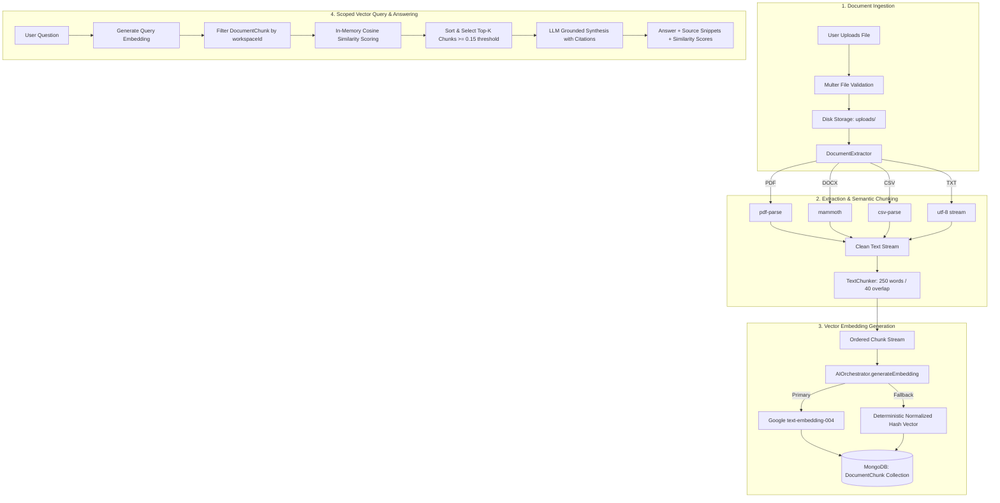

# VentureOS | Document RAG & Vector Retrieval Architecture

This document details the document processing, semantic chunking, vector embedding, cosine similarity retrieval, and grounded question-answering architecture implemented in **VentureOS**.

---

## 1. Document RAG Pipeline Flow



---

## 2. Ingestion & File Extraction (`document.extractor.ts`)

The `DocumentExtractor` handles binary-to-text conversion across four enterprise document formats:

| Format | Library | Extraction Method | Metadata Captured |
| :--- | :--- | :--- | :--- |
| **PDF** | `pdf-parse` | Extracts raw page text streams and document info dictionary | `numPages`, `info` |
| **DOCX** | `mammoth` | Extracts clean raw text while stripping styling artifacts | Parser warning messages |
| **CSV** | `csv-parse/sync` | Transforms tabular rows into descriptive key-value text pairs | `rowCount` |
| **TXT** | Native Node `fs` | Decodes UTF-8 string buffer directly | File byte size |

---

## 3. Sliding-Window Semantic Chunking (`chunker.ts`)

To maintain sentence context while respecting embedding model token limits, the `TextChunker` implements a sliding-window chunking strategy:

- **Target Chunk Size**: **250 words** (~325–350 tokens).
- **Window Overlap**: **40 words** sliding overlap to ensure boundary concepts are preserved across chunks.
- **Chunk Metadata**: Every chunk stores `chunkIndex`, `tokenCount`, `wordCount`, estimated `page` number (`Math.floor(i / 350) + 1`), and structural `section` label.

---

## 4. Vector Embedding & Fallback Resiliency

1. **Primary Model**: Google `text-embedding-004` (generates 768-dimensional float32 vector embeddings).
2. **Resilient Offline Fallback**: If the external embedding API is throttled or the API key is not configured, `AIOrchestrator` switches to a deterministic 64-dimensional normalized hash vector generator. This guarantees that local development and unit tests can execute RAG queries without third-party network dependencies.

---

## 5. Similarity Search & Scoping (`vector.service.ts`)

Cosine similarity between the query embedding $Q$ and candidate chunk embedding $C$ is computed in TypeScript:

$$\text{CosineSimilarity}(Q, C) = \frac{\sum_{i=1}^n Q_i C_i}{\sqrt{\sum_{i=1}^n Q_i^2} \cdot \sqrt{\sum_{i=1}^n C_i^2}}$$

### Tenant Partitioning Guarantee
Before computing cosine similarity, candidates are queried using:
```ts
const chunks = await DocumentChunk.find({
  workspaceId: new mongoose.Types.ObjectId(workspaceId)
}).populate('documentId', 'title');
```
Chunks from other workspaces are never loaded into server memory.

---

## 6. Grounded Question Answering (`/api/documents/rag/ask`)

The top-$k$ relevant chunks (default $k=4$, minimum similarity score $ge 0.15$) are formatted into the LLM system prompt:

```
VERIFIED DOCUMENT CONTEXT:
[Source 1: Master Service Agreement.pdf, Section 2 (Score: 0.8421)]
Payment terms are net 30 days upon invoice receipt. Late fees accrue at 1.5% per month...

QUESTION:
What are our payment terms and late fee policies?
```

The response returns:
- Synthesized natural-language answer.
- An array of `citations` containing `documentTitle`, `section`, text `snippet`, and numeric `similarityScore`.
