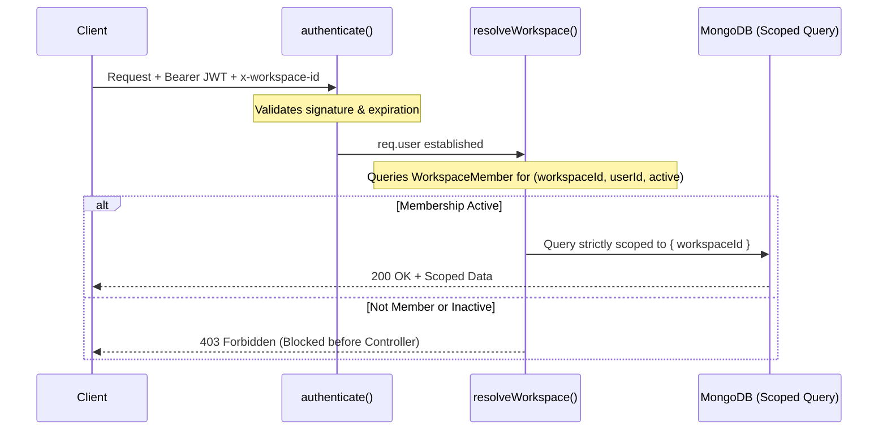

# VentureOS | Security Architecture & Governance Specification

This document details the security controls, cryptographic measures, tenant isolation patterns, and data governance policies implemented across the **VentureOS** platform.

---

## 1. Authentication & Session Architecture

### JWT Token Issuance & Verification
- **Cryptographic Standard**: HMAC-SHA256 (`HS256`) signatures utilizing a high-entropy secret key (`JWT_SECRET`).
- **Token Claims Payload**:
  ```json
  {
    "userId": "67b8a1c9e4b0a1d2e3f4a5b6",
    "email": "user@company.io",
    "name": "Jane Doe",
    "iat": 1740000000,
    "exp": 1740604800
  }
  ```
- **Token Lifespan**: Defaults to `7d` (`JWT_EXPIRES_IN`). Expired tokens are immediately rejected by `authenticate` middleware with `HTTP 401 Unauthorized`.
- **Client Transmission**: Transmitted via HTTP header `Authorization: Bearer <token>`. Never stored in insecure URL query parameters.

### Password Storage & Salting
- **Algorithm**: `bcryptjs` with a work factor of **10 salt rounds**.
- **Timing Attack Resistance**: Constant-time comparison via `bcrypt.compare()`.
- **Plaintext Elimination**: Plaintext passwords are never logged, never returned in user API responses (`select: false` or excluded in serialization), and never stored.

---

## 2. Multi-Tenant Workspace Isolation

VentureOS enforces **strict tenant isolation** at the database layer. No user can read or mutate data belonging to another workspace, even with a valid JWT.



### Isolation Invariants:
1. **Active Membership Verification**:
   The `resolveWorkspace` middleware queries the `WorkspaceMember` collection for:
   ```ts
   { workspaceId: toObjectId(workspaceId), userId: toObjectId(req.user.userId), status: 'active' }
   ```
   If the record does not exist or has `status !== 'active'`, the request is blocked immediately with `HTTP 403 Forbidden`.
2. **Compound Database Indexes**:
   Every tenant-owned collection includes a mandatory compound index on `workspaceId`:
   ```ts
   LeadSchema.index({ workspaceId: 1, status: 1 });
   CustomerSchema.index({ workspaceId: 1, customerHealthScore: 1 });
   TaskSchema.index({ workspaceId: 1, status: 1 });
   DocumentChunkSchema.index({ workspaceId: 1, documentId: 1 });
   FinancialRecordSchema.index({ workspaceId: 1, date: -1 });
   AIConversationSchema.index({ workspaceId: 1, userId: 1, updatedAt: -1 });
   ```
3. **Controller Scoping**:
   Controllers derive the target workspace solely from `req.workspace.workspaceId` (validated by middleware). Workspace IDs from user request bodies or URL parameters are never blindly trusted for cross-tenant operations.

---

## 3. Role-Based Access Control (RBAC)

The `requireRole` middleware enforces granular hierarchical permissions across five defined roles:

| Role | Hierarchy Level | Capabilities & Permissions |
| :--- | :--- | :--- |
| **Owner** | Level 5 (Highest) | Full workspace destruction, billing changes, company metadata updates, team invitation & role reassignment, and all operations. |
| **Admin** | Level 4 | Full team management (except Owner demotion), system settings, automation rules, and all operational modules. |
| **Manager** | Level 3 | Project creation, AI Project Plan instantiation, lead conversion, marketing campaign launches, meeting analysis, and document uploads. |
| **Employee** | Level 2 | Task updating, lead interaction logging, customer feedback entry, and view access across modules. |
| **Viewer** | Level 1 (Lowest) | Read-only access across all business intelligence and reporting screens. Write operations are blocked with `403 Forbidden`. |

---

## 4. AI Safety, Tool Authorization & Human-in-the-Loop

AI integrations operate under strict safety guardrails designed to prevent unauthorized mutations, prompt injections, and data exfiltration.

### Bounded Read-Only Tools vs. Action Proposals
- **Read Tools**: Tools like `getRevenueData`, `getSalesPipeline`, `getCustomerDetails`, and `getProjectStatus` execute read-only MongoDB queries scoped strictly to `req.workspace.workspaceId`.
- **Write Actions**: Tools that modify state (e.g. `createTask`, `createProject`, `createMarketingCampaign`) do **not** write to the database directly. Instead, they return an **Action Proposal**:
  ```json
  {
    "isActionProposal": true,
    "actionType": "createTask",
    "payload": { "title": "Follow up with Marcus Brody", "priority": "high" },
    "summary": "Proposes creating a high-priority follow-up task"
  }
  ```
  The user must review the proposal in the UI and explicitly approve it via `POST /api/ai/copilot/approve-action` before any record is created.

### Prompt Injection Mitigation & Model Isolation
- **System Instructions**: System instructions are supplied via the official SDK's configuration parameter (`systemInstruction` in Gemini, `system` message in OpenAI), isolating system-level behavior from untrusted user inputs.
- **Tool Result Wrapping**: Tool results returned to the model are structured as verified JSON blocks rather than executable code.
- **RAG Context Boundaries**: Document chunks injected into prompts are delineated with explicit source tags (`[Source 1: Title]`) and the model is instructed to answer strictly using grounded context.

---

## 5. File Upload & Storage Security

Document uploads (`POST /api/documents/upload`) are guarded by multi-layer defenses:

1. **Allowed Extensions & MIME Validation**:
   - Permitted types: `.pdf` (`application/pdf`), `.docx` (`application/vnd.openxmlformats-officedocument.wordprocessingml.document`), `.csv` (`text/csv`), `.txt` (`text/plain`).
   - Executable extensions (`.exe`, `.sh`, `.bat`, `.js`, `.php`) are blocked.
2. **File Size Limit**:
   - Enforced by Multer: maximum 15 MB (`MAX_FILE_SIZE_MB`). Oversized files are rejected before processing.
3. **Randomized File Storage**:
   - Stored with cryptographically random filenames: `${Date.now()}-${Math.round(Math.random() * 1e9)}.${ext}`. This prevents path traversal attacks (`../../etc/passwd`) and filename collision exploits.

---

## 6. Network Security & HTTP Headers

- **Helmet.js**: Sets security headers including `X-DNS-Prefetch-Control`, `X-Frame-Options: SAMEORIGIN`, `X-Content-Type-Options: nosniff`, and `Strict-Transport-Security`.
- **CORS Protection**: Access is restricted to trusted origins defined in `CLIENT_URL` with credentials support enabled.
- **Rate Limiting**: `express-rate-limit` enforces a quota of 1,000 requests per 15-minute window per IP address on all `/api/*` routes.

---

## 7. Audit Logging & Compliance

Every state-changing operation, AI tool invocation, and action approval is immutably recorded in the `AuditLog` collection:

```ts
{
  workspaceId: ObjectId("..."),
  userId: ObjectId("..."),
  action: "project.ai_plan_approved",
  resource: "Project",
  resourceId: "6ad90b0f24a6724571b9d476",
  details: { projectName: "SOC2 Pipeline", taskCount: 6 },
  ipAddress: "127.0.0.1",
  createdAt: ISODate("2026-10-21T23:57:15.000Z")
}
```

Audit logs cannot be modified or deleted through the user interface or standard API endpoints.

---

## 8. Known Production Considerations
- **HTTPS Enforcement**: In local development, HTTP is standard. For cloud deployments (Render, AWS, GCP), TLS/SSL must be terminated at the reverse proxy or CDN layer.
- **Database Encryption**: In production, utilize MongoDB Atlas with Encryption at Rest (AES-256) and TLS 1.3 in-transit encryption.
